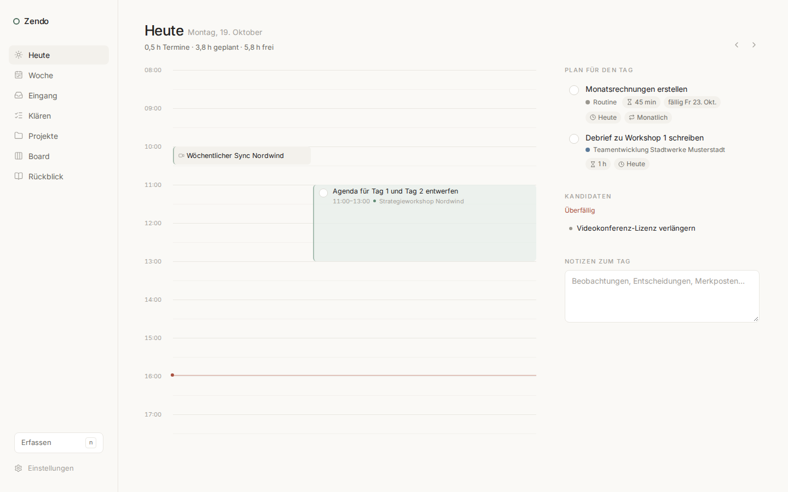
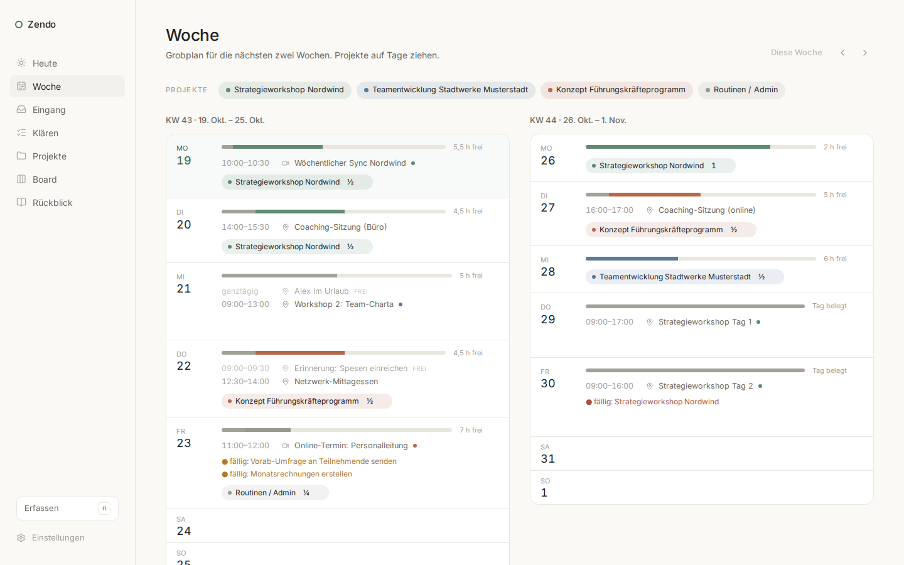
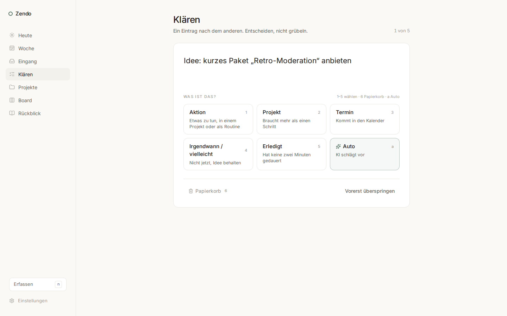
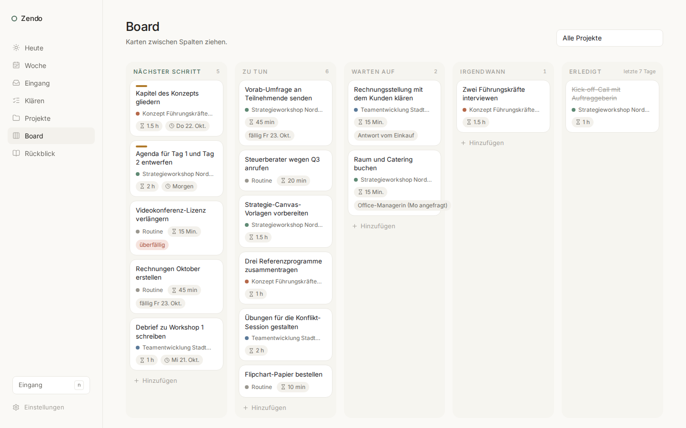
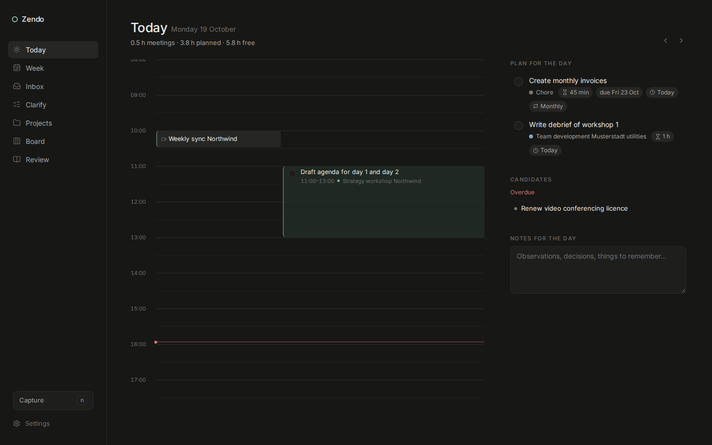

# Zendo

A minimal, calm todo and planning app inspired by *Getting Things Done*, built for one person and served on localhost.

- **Capture** anything into the inbox with one keystroke (`n`).
- **Clarify** the inbox one item at a time into actions, projects, meetings, someday or trash.
- **Projects** with exactly one next action each; chores for everything that is not a project.
- **Board** (kanban), **Week** (rolling two-week plan with ½-day blocks against your calendar), **Today** (timeline and daily list), **Review** (daily and weekly).
- German and English UI, light and dark, keyboard-first, drag and drop where it helps.
- Optional AI help (bring your own Claude or ChatGPT key) and Outlook calendar import.

## Screenshots

Fictional sample data, German UI, light theme (dark theme follows the system).







## Status

Iteration 0: a design prototype. Data lives in the browser's local storage on your machine. See [docs/requirements.md](docs/requirements.md), [docs/architecture.md](docs/architecture.md) and the research notes in [docs/](docs/).

## Run it

```bash
npm install
npm run dev          # UI on http://127.0.0.1:5173 plus the local calendar service (if a .env exists)
```

Other scripts: `npm run web` (UI only), `npm run calendar:serve` (calendar service only), `npm run calendar:check` (verify the Microsoft 365 registration), `npm test`, `npm run build`, `npm run preview`.

To see your Outlook calendar in Zendo, register an app once ([docs/outlook-setup.md](docs/outlook-setup.md)), put the two IDs into `.env`, start `npm run dev` and press **Connect Microsoft 365** in Settings. The sign-in tokens stay in `data/` (gitignored).

The first start loads fictional sample data so you can explore. Settings → Data lets you clear it, export/import JSON, or reload the sample.

## Keyboard

| Key | Action |
|---|---|
| `n` | Capture to inbox |
| `g` then `t` / `w` / `i` / `c` / `p` / `b` / `r` | Go to Today / Week / Inbox / Clarify / Projects / Board / Review |
| `1`–`6` | On Clarify: choose the kind |
| `Esc` | Close dialogs and the task drawer |

## Privacy

This repository is public. Personal data never belongs in it:

- App data stays in your browser (prototype) or in the gitignored `data/` folder (planned).
- API keys are stored only in your browser's local storage (prototype) or `.env` (planned) and are excluded from exports.
- The Microsoft 365 token cache lives in `data/msal-cache.json` and is gitignored. Delete it (or press Disconnect) to sign out.
- `.gitignore` already covers `data/`, `*.db`, `*.ics`, `.env*` and MSAL token caches. Keep it that way.
- Sample data is fictional. Use it for screenshots.

## Licence

MIT – see [LICENSE](LICENSE).
